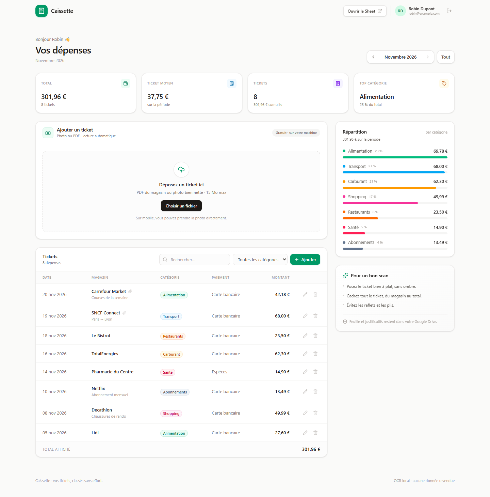

# Caissette

Gestionnaire de dépenses familial : on envoie un ticket de caisse (PDF du magasin ou photo), l'application en extrait la date, le montant, le magasin et la catégorie, puis complète automatiquement **votre propre Google Sheet**. Tout est modifiable à la main.

- **Lecture locale** : les PDF sont lus directement, les photos passent par Tesseract (OCR) exécuté sur votre machine.
- **Données chez vous** : la feuille de calcul et les justificatifs sont créés dans **votre** Google Drive. Le serveur ne stocke ni base de données ni fichiers.
- **Connexion Google** : chaque membre de la famille se connecte avec son compte et obtient sa propre feuille.
- **Interface** : tableau de bord responsive, graphique par catégorie, recherche, édition et suppression en un clic.



---

## 1. Ce dont vous avez besoin

- Node.js **24 ou plus** (testé avec Node 24.20 ; `unpdf` nécessite Node 24)
- Un compte Google
- Une connexion internet au premier ticket photo (téléchargement du modèle OCR français)

> ⚠️ Le fichier `credentials.json` (compte de service) présent à la racine **n'est pas utilisé** par l'application. Un compte de service ne peut pas créer de fichier dans le Drive d'un utilisateur : il faut des identifiants OAuth « Application Web ». Vous pouvez supprimer `credentials.json` (il est déjà exclu de Git) ; en tout cas, ne le partagez jamais.

---

## 2. Installer l'application

```bash
npm install
```

Puis renseignez le fichier `.env.local` (modèle : `.env.example`) :

```env
GOOGLE_CLIENT_ID=...
GOOGLE_CLIENT_SECRET=...
SESSION_SECRET=...
APP_URL=http://localhost:3000
ALLOWED_EMAILS=
```

> Si le port 3000 est déjà utilisé sur votre machine, mettez `APP_URL=http://localhost:3001` et lancez `npm run dev` ou `npm start -- -p 3001`. Déclarez alors aussi `http://localhost:3001/api/auth/callback` dans Google Console. C'est la configuration actuelle de ce poste.

Générez la clé de session avec :

```bash
node -e "console.log(require('crypto').randomBytes(32).toString('base64'))"
```

`ALLOWED_EMAILS` est optionnel : renseignez les adresses des membres de la famille, séparées par des virgules, pour interdire l'accès à tout autre compte Google.

---

## 3. Configurer Google (une seule fois)

### 3.1 Créer le projet et activer les API

1. Ouvrez [Google Cloud Console](https://console.cloud.google.com/) et créez un projet (par exemple `caissette`).
2. Menu **API et services → Bibliothèque**.
3. Activez **Google Sheets API**.
4. Activez **Google Drive API**.

### 3.2 Configurer l'écran de consentement OAuth

1. **API et services → Écran de consentement OAuth**.
2. Type d'utilisateur : **Externe**, puis remplissez le nom de l'application, l'e-mail d'assistance et l'e-mail du développeur.
3. Dans **Portées**, ajoutez :
   - `openid`
   - `.../auth/userinfo.email`
   - `.../auth/userinfo.profile`
   - `https://www.googleapis.com/auth/drive.file`

   > `drive.file` est un accès **non sensible** : il permet à l'application d'accéder uniquement aux fichiers qu'elle a créés (la feuille de calcul et les tickets). C'est ce qui évite l'avertissement Google « application non validée ».
4. Ajoutez les comptes Google de la famille dans **Utilisateurs tests**.
5. **Publication :** l'application actuelle est **déjà publiée en production** avec la page d'accueil et la politique de confidentialité servies par Render. Comme elle ne demande que des portées **non sensibles** (`drive.file` + identité), Google n'affiche **aucun avertissement de vérification**. Il n'y a donc rien d'autre à faire. Si vous ajoutiez un jour un scope sensible (`spreadsheets`, Gmail…), il faudrait republier et éventuellement faire vérifier l'application.

### 3.3 Créer les identifiants OAuth

1. **API et services → Identifiants → Créer des identifiants → ID client OAuth**.
2. Type d'application : **Application Web**.
3. **URI de redirection autorisés** :
   - `http://localhost:3000/api/auth/callback`
   - et, si vous utilisez un accès distant, l'URL HTTPS correspondante (voir section 6).
4. Copiez le **Client ID** et le **Client Secret** dans `.env.local`.

### 3.4 Activer l'import Google Drive (facultatif)

L'import Drive permet de choisir un PDF ou une photo déjà présent dans le Drive, sans le retélécharger. Il utilise **Google Picker** et une clé API navigateur.

1. Dans **API et services → Bibliothèque**, activez **Google Picker API**.
2. Dans **Identifiants → Créer des identifiants → Clé API**, créez une clé.
3. Restreignez-la :
   - **Restrictions d'API** : Google Drive API et Google Picker API ;
   - **Restrictions relatives aux applications → Sites Web** : votre URL Render, `http://localhost:3000/*`, `http://localhost:3001/*` et `https://docs.google.com/*`.
4. Ajoutez dans `.env.local` et dans Render :
   ```env
   GOOGLE_PICKER_API_KEY=AIza...
   GOOGLE_PROJECT_NUMBER=93860449537
   ```
   (`GOOGLE_PROJECT_NUMBER` est le numéro du projet, visible dans **IAM et administration → Paramètres**.)

Sans cette clé, le bouton « Importer depuis Google Drive » affiche une erreur de configuration ; le reste de l'application fonctionne normalement.

Lancez ensuite :

```bash
npm run dev
```

Ouvrez [http://localhost:3000](http://localhost:3000) et connectez-vous avec Google. Au premier chargement du tableau de bord, Caissette crée automatiquement :

- le classeur **« Dépenses — Caissette »** ;
- le dossier **« Tickets de caisse — Caissette »** qui archive les originaux.

Les deux sont accessibles depuis votre Google Drive.

> **État de cette installation :** le client OAuth « Caissette Web » est créé avec les URI `http://localhost:3000/api/auth/callback`, `http://localhost:3001/api/auth/callback` et `https://caissette.onrender.com/api/auth/callback`. L'application est **déployée en ligne sur [https://caissette.onrender.com](https://caissette.onrender.com)** (Render, plan gratuit). Elle n'utilise que le scope **non sensible** `drive.file` : **aucun avertissement Google « application non validée »** n'apparaît, et les autorisations ne sont pas limitées à 7 jours. Le compte `robin.massonfauchier@gmail.com` est autorisé comme utilisateur test et dans `ALLOWED_EMAILS`. La feuille et le dossier ont été créés dans le Drive de ce compte. Pour ajouter un membre de la famille : ajoutez son adresse e-mail dans `ALLOWED_EMAILS` (séparée par une virgule) **dans les variables d'environnement Render**, puis redéployez. L'ajout aux « Utilisateurs tests » n'est plus nécessaire avec le scope non sensible `drive.file` (il reste possible, sans effet).

---

## 4. Utilisation

1. **Déposez un PDF ou une photo** dans la zone d'import (ou cliquez pour choisir un fichier).
2. Quelques secondes plus tard, une fenêtre s'ouvre avec les champs pré-remplis. Les incertitudes sont signalées en jaune.
3. Corrigez si besoin, choisissez la catégorie et enregistrez.
4. La ligne est ajoutée au Google Sheet et le tableau de bord se met à jour.

Vous pouvez aussi :

- **Ajouter** une dépense manuellement (`Ajouter`) ;
- **Modifier** une ligne (clic sur la ligne, crayon) ;
- **Supprimer** une ligne (corbeille) ;
- **Importer un ticket depuis Google Drive** avec le bouton dédié (PDF ou photo déjà présent dans le Drive) ;
- **Filtrer** par mois, par catégorie ou par recherche ;
- **Consulter les statistiques** : évolution mensuelle, répartition par catégorie, moyens de paiement, jours de la semaine, top magasins, comparaison avec le mois précédent et budget ;
- **Régler vos paramètres** : budget mensuel, catégorie par défaut, import Drive, compte Google ;
- **Ouvrir le Sheet** à tout moment depuis l'en-tête.

### Colonnes de la feuille

| Date | Magasin | Catégorie | Montant | TVA | Paiement | Note | Ticket | Ajouté le |
| ---- | ------- | --------- | ------- | --- | -------- | ---- | ------ | --------- |

Les catégories proposées : Alimentation, Restaurants, Transport, Carburant, Santé, Logement, Loisirs, Shopping, Abonnements, Divers.

### Ce que l'application sait lire

- PDF **textuels** (Carrefour, Leclerc, Amazon, SNCF, factures en ligne…) : extraction directe, très fiable.
- **Photos** JPG/PNG/WebP/HEIC : OCR local, puis détection de la date, du total, de la TVA, du moyen de paiement et du magasin (liste de marques françaises + heuristiques).
- Les **PDF scannés** (image dans un PDF) ne sont pas OCRisés : l'application vous invite à envoyer une photo ou à saisir la dépense à la main.
- Un ticket mal lu reste toujours modifiable avant enregistrement.

---

## 5. Lancer en production sur votre PC

```bash
npm run build
npm start
```

L'application écoute sur `http://localhost:3000`.

Pour qu'elle démarre automatiquement avec Windows, créez une tâche dans le **Planificateur de tâches** :

- Déclencheur : « À l'ouverture de session »
- Action : démarrer un programme
  - Programme : `C:\Program Files\nodejs\npm.cmd`
  - Arguments : `start`
  - Démarrer dans : `C:\Users\robin\Documents\Code\ticket_de_caisse`

Le PC doit rester allumé pour un accès permanent.

---

## 6. Accès en ligne et depuis les téléphones

### 6.1 Déploiement Render actuel (gratuit, sans PC allumé)

L'application est déjà en ligne sur **https://caissette.onrender.com**.

- Dépôt du code : [github.com/RobinMassonFauchier/caissette](https://github.com/RobinMassonFauchier/caissette)
- Plan Render **Free** : 512 Mo de RAM, 0,1 CPU, mise en veille après 15 minutes d'inactivité. Un workflow GitHub Actions (`.github/workflows/keep-alive.yml`) ping la page toutes les 10 minutes pour la garder éveillée.
- Les secrets (`GOOGLE_CLIENT_ID`, `GOOGLE_CLIENT_SECRET`, `SESSION_SECRET`, `ALLOWED_EMAILS`) sont configurés dans **Render → Environment**, jamais dans le dépôt.
- Mise à jour : `git push origin master`, puis dans Render **Manual Deploy → Deploy latest commit**. Le déploiement automatique n'est pas actif pour une source « Public Git Repository » ; il faut donc cette dernière étape.
- L'OCR prend environ 20 à 60 secondes sur le plan gratuit (contre quelques secondes en local). C'est normal.
- Le service se rendort si GitHub Actions est interrompu ; le premier accès prend alors environ une minute.
- L'écran de consentement ne demande que `drive.file` et l'identité : **aucun avertissement de vérification Google**, et plus de reconnexion tous les 7 jours.

### 6.2 Accès privé avec Tailscale (optionnel)

Tailscale reste utile si vous voulez un accès **strictement privé**, sans passer par Internet. Il faut alors que le PC soit allumé.

Google n'accepte **pas** les URL de redirection en `http://` vers une adresse IP locale (`http://192.168.1.20:3000`). Trois solutions :

### Option recommandée : Tailscale (privé, gratuit, HTTPS)

1. Installez [Tailscale](https://tailscale.com/) sur le PC et sur les téléphones (même compte).
2. Sur le PC, dans un terminal :

   ```bash
   tailscale serve --bg 3000
   ```

3. Tailscale affiche une URL du type `https://mon-pc.tailXXXX.ts.net`.
4. Ajoutez dans Google Console l'URI de redirection :
   `https://mon-pc.tailXXXX.ts.net/api/auth/callback`
5. Dans `.env.local`, mettez `APP_URL=https://mon-pc.tailXXXX.ts.net`, puis redémarrez l'application.

L'accès reste privé au réseau Tailscale (pas exposé à Internet).

### Option tunnel Cloudflare

```bash
cloudflared tunnel --url http://localhost:3000
```

Cloudflare fournit une URL HTTPS. Ajoutez-la (avec `/api/auth/callback`) dans Google Console et mettez-la dans `APP_URL`. Pour une URL stable, utilisez un tunnel nommé avec votre propre domaine.

### Option domaine + reverse proxy

Placez Caddy ou nginx devant l'application avec un certificat HTTPS, puis déclarez l'URL dans Google Console et dans `APP_URL`.

Dans tous les cas, `APP_URL` doit correspondre **exactement** à l'URI déclarée dans Google Console (schéma, domaine, port, pas de `/` final).

---

## 7. Sécurité et vie privée

- La session est un cookie chiffré (iron-session), valable 30 jours, `httpOnly`.
- Le refresh token Google est stocké **uniquement dans ce cookie chiffré** ; aucune base de données.
- L'application ne demande que la portée `drive.file` : elle ne voit que les fichiers **qu'elle a créés**.
- **Pourquoi aucun avertissement Google ?** Le scope `spreadsheets` (considéré comme sensible) n'est **pas** demandé. Caissette crée elle-même la feuille et y accède via `drive.file`, qui est non sensible et recommandé par Google pour ce cas. C'est ce qui supprime l'écran « application non validée ».
- Les justificatifs sont archivés dans le Drive de l'utilisateur, jamais sur le serveur.
- `ALLOWED_EMAILS` permet de fermer l'accès aux seuls comptes autorisés.
- Pour révoquer complètement l'accès : [myaccount.google.com/permissions](https://myaccount.google.com/permissions).
- Ne versionnez jamais `.env.local`, `credentials.json` ni un export de vos tickets.

---

## 8. Dépannage

| Problème | Solution |
| -------- | -------- |
| `redirect_uri_mismatch` | `APP_URL` et l'URI déclarée dans Google Console doivent être identiques (http/https, port, pas de slash final). Redémarrez après modification de `.env.local`. |
| « Google a refusé l'accès » | Vérifiez que **Sheets API** et **Drive API** sont activées. Attendez quelques minutes après l'activation, puis reconnectez-vous. |
| Écran Google « application non validée » | Cet écran ne doit plus apparaître : l'application n'utilise que `drive.file`. Si vous l'avez encore, c'est que votre compte a accordé l'ancienne version avec le scope Sheets. Révoquez l'accès sur [myaccount.google.com/permissions](https://myaccount.google.com/permissions), puis reconnectez-vous. |
| Le service Render met du temps à répondre | Le plan gratuit s'endort après 15 minutes ; le premier accès peut prendre une minute. Le workflow GitHub Actions le garde éveillé. |
| « Ce PDF ne contient pas de texte exploitable » | PDF scanné : envoyez une photo du ticket ou saisissez-le manuellement. |
| OCR vide / illisible | Photo à plat, ticket entier, bonne lumière, sans reflet. Le premier essai nécessite internet. |
| Le port 3000 est occupé | `npm start -- -p 3001`, et adaptez `APP_URL` + l'URI Google. |
| Erreur d'installation de `sharp` | `npm rebuild sharp` puis relancez. |
| Le tableau reste vide après ajout | Vérifiez que la ligne apparaît dans le Sheet. Sinon, regardez les logs du terminal (erreur Google). |

Les tests utilitaires (sans Google) :

```bash
npm run test:parser   # heuristiques de lecture de tickets
npm run test:pdf      # extraction de texte d'un PDF
npm run test:ocr      # OCR d'une image (télécharge le modèle au premier lancement)
```

---

## 9. Structure du projet

```
src/
├─ app/
│  ├─ page.tsx                 # page d'accueil / connexion
│  ├─ app/page.tsx             # tableau de bord (serveur)
│  └─ api/
│     ├─ auth/...              # OAuth Google (login, callback, logout)
│     ├─ extract/route.ts      # upload + OCR/PDF + analyse
│     └─ expenses/...          # ajout, modification, suppression
├─ components/
│  ├─ landing/                 # page publique
│  ├─ dashboard/               # tableau de bord, table, import, formulaire
│  └─ ui/                      # modale, confirmation
└─ lib/
   ├─ google.ts                # client OAuth
   ├─ sheet.ts                 # Google Sheets + Drive
   ├─ ocr.ts                   # Tesseract + pretraitement d'image
   ├─ parse-receipt.ts         # heuristiques tickets français
   └─ ...
```

---

## 10. Limites connues (v1)

- Une feuille par compte Google (pas de budget partagé entre plusieurs comptes).
- Pas d'OCR sur les PDF scannés.
- La détection des tickets est heuristique : les tickets très abîmés ou les enseignes peu connues demandent une correction manuelle.
- Pas d'import de relevés bancaires ni de récurrences automatiques.
- L'application doit tourner sur une machine allumée (PC familial ou petit serveur).
